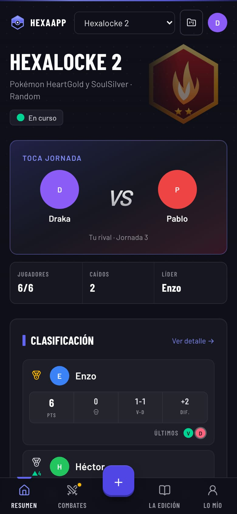
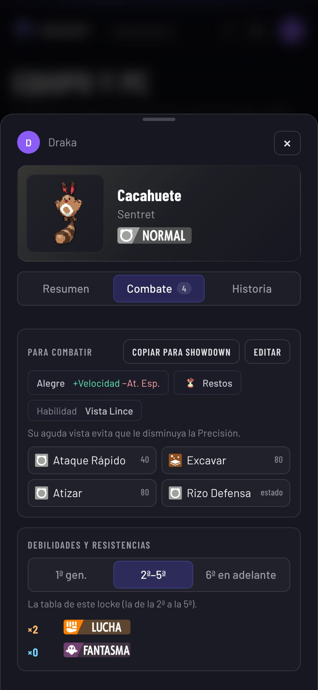
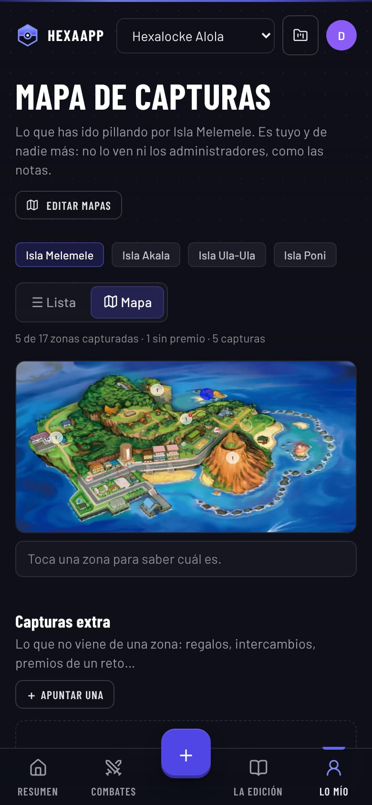
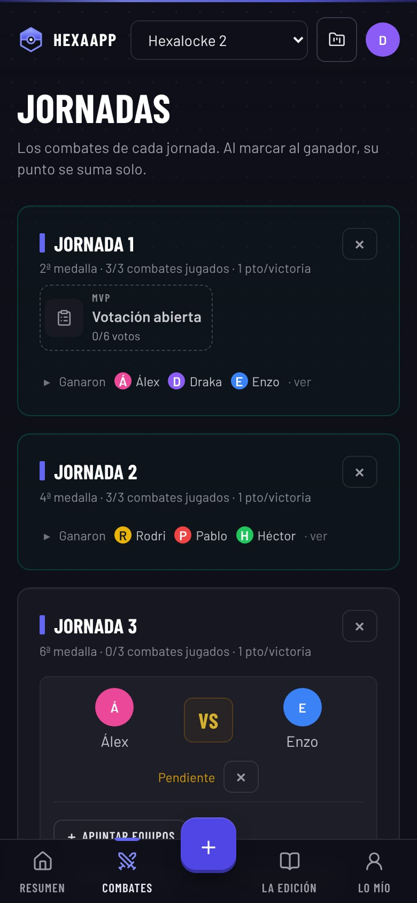

# HexaApp

**La aplicación con la que un grupo de amigos juega sus nuzlockes de Pokémon por
puntos**: jornadas de combates, clasificación, level caps, cementerio, mapa de
capturas, el equipo y la caja de cada uno, ruletas, sorteos, final a cuatro y un
palmarés de todas las ediciones. Web instalable en el móvil (PWA), en
producción y en uso de verdad: **[hexa-app-taupe.vercel.app](https://hexa-app-taupe.vercel.app)**
(con cuenta; las capturas de abajo son de una partida de ejemplo).

<p align="center">
  
  
  
  
</p>

## Qué es un Hexalocke

Un *nuzlocke* es un reto de Pokémon con normas propias: solo se captura el
primer pokémon de cada ruta y el que cae se da por muerto. El **Hexalocke** lo
convierte en una competición: varios jugadores avanzan a la vez, cada pocos
gimnasios hay una **jornada de combates** entre ellos, se suman puntos y al final
los mejores se juegan el título. Llevarlo en notas y grupos de mensajería era un
caos; HexaApp lo junta todo en un sitio.

## Lo que hace

- **Competición**: jornadas con emparejamientos automáticos tipo liguilla (o al
  mejor de tres), resultados que suman puntos solos, clasificación con
  desempates, final a cuatro con su cuadro, MVP votado y Battle Royale.
- **El juego de cada uno**: equipo y caja como el PC de los juegos (arrastrar,
  evolucionar con su animación, shiny, intercambios, deshacer), cementerio de
  lápidas y un **mapa de capturas** sobre el dibujo de cada región, con un editor
  de zonas a medida (polígonos, rutas partidas en trozos).
- **Lee las partidas de verdad**: el archivo de guardado de los juegos oficiales
  de la 1ª a la 7ª generación (y de un fangame) se interpreta en el navegador y
  pone al día el equipo; y de una repetición de Pokémon Showdown se saca el
  resultado y los equipos del combate.
- **Organización**: varias ediciones a la vez con su archivo histórico,
  permisos por edición, espectadores, reglamento con avisos de cambios, ruletas
  y sorteos, bolsa de objetos, copias de seguridad automáticas y un buzón de
  sugerencias.
- **Funciona sin conexión**: lo que se apunta sin línea se guarda en una cola y
  se sube solo al volver, sin duplicarse.

## Por dentro

- **Next.js 16** (App Router y Server Actions), **React 19**, **TypeScript**,
  **Tailwind CSS 4** y **Prisma** sobre **PostgreSQL** (Neon). Desplegada en
  **Vercel**: cada cambio en la rama principal se publica solo.
- **Permisos en el servidor**, dentro de cada acción: ocultar un botón nunca se
  da por comprobación. Se ha probado atacándola de verdad —llamando a las ~200
  acciones con identificadores ajenos, sin sesión y con cada tipo de cuenta— y
  comparando la base de datos fila a fila.
- **Seguridad**: contraseñas con bcrypt, sesión firmada en cookie `httpOnly`
  revocable, freno a los intentos de entrada, cabeceras y CSP, imágenes servidas
  sin poder ejecutar nada y descargas externas con límites.
- **Pruebas**: 290 pruebas de las reglas del juego (puntos, desempates,
  emparejamientos, lectura de partidas…) que paran el despliegue si fallan, y
  122 pruebas de interfaz con Playwright que recorren la app como un usuario.
- **Imágenes ligeras**: se reducen en el navegador antes de subirlas y los
  sprites se preparan una vez en el servidor y se sirven con caché.

## Cómo se ha hecho

El proyecto lo ha diseñado y dirigido **Drakarai**: qué se construye, cómo
funciona cada regla y cómo se ve, probándolo con el grupo que lo usa. El código
se ha escrito con **Claude Code**, un asistente de programación con IA.
[`PROYECTO.md`](PROYECTO.md) recoge cada decisión con su porqué, y
[`CLAUDE.md`](CLAUDE.md), las normas de trabajo del repositorio.

## Ponerla en marcha

Hace falta Node 20+ y una base de datos PostgreSQL (vale una gratuita de
[Neon](https://neon.com)).

```bash
npm install
cp .env.example .env      # pon tu DATABASE_URL y un AUTH_SECRET largo
npm run setup             # crea las tablas y carga una edición de ejemplo
npm run dev               # http://localhost:3000
```

La edición de ejemplo trae las cuentas `admin`, `draka`, `pablo`, `hector`,
`rodri`, `enzo` y `alex`, con la contraseña de `SEED_PASSWORD` (`hexalocke` por
defecto). Con una base de datos vacía y `npm run db:push`, la primera visita
abre una pantalla de instalación para crear la cuenta principal.

| Orden | Para qué |
| --- | --- |
| `npm test` | Las pruebas de las reglas (van dentro del build) |
| `npm run test:interfaz` | Las pruebas de interfaz, tras `npm run build` |
| `npm run build` | Pruebas, tablas al día y compilación |
| `npm run users` | Ver usuarios o cambiar una contraseña desde la terminal |

Cómo publicarla en Vercel e instalarla en el móvil: [`DEPLOY.md`](DEPLOY.md).
Las guías de uso en PDF salen de [`guia/`](guia/README.md).

```
src/
  app/(app)/     una carpeta por pantalla
  app/actions/   server actions, con sus permisos
  app/api/       imágenes, sprites, sincronización sin conexión
  components/    piezas de interfaz compartidas
  lib/           reglas del juego, permisos, lectura de partidas…
prisma/          modelo de datos y datos de ejemplo
tests/           pruebas de las reglas e interfaz/ con Playwright
guia/            las guías en PDF y cómo se rehacen
```

## Licencia

© 2026 Drakarai. **Todos los derechos reservados**: el código se puede leer,
pero no copiar, modificar ni usar sin permiso (ver [`LICENSE`](LICENSE)).
Pokémon y sus nombres, imágenes y sonidos son de Nintendo, Creatures Inc. y
GAME FREAK inc.; HexaApp es un proyecto de fans sin ánimo de lucro y sin relación
con ellos.
